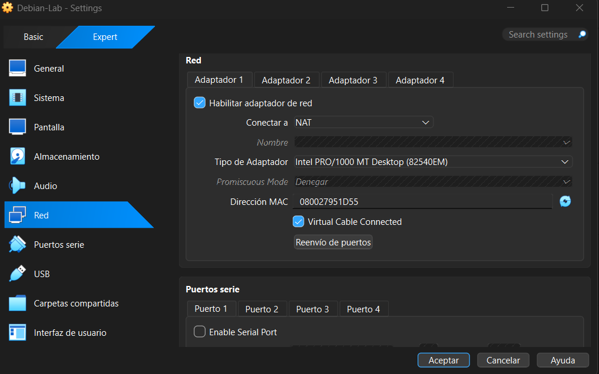
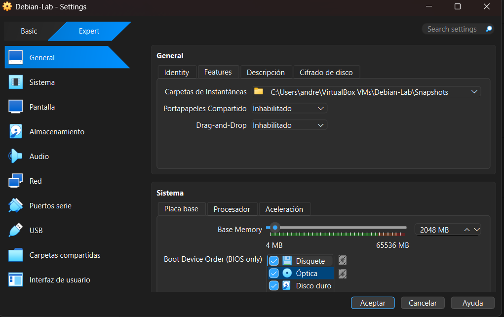
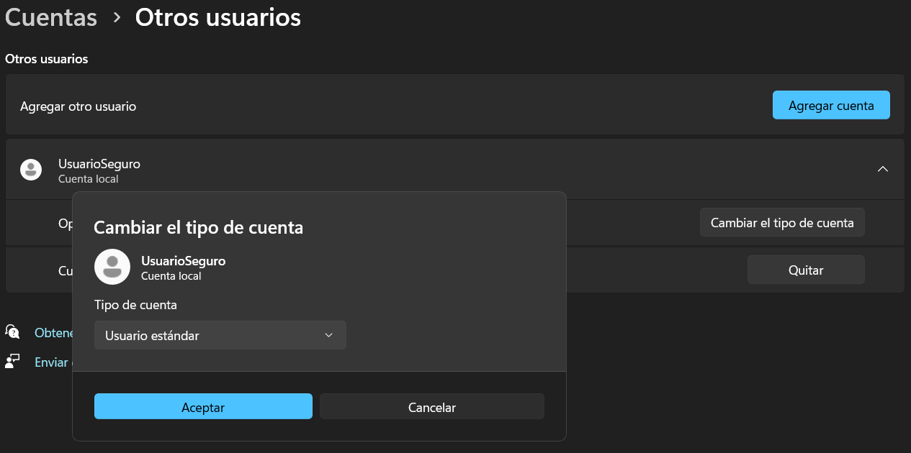
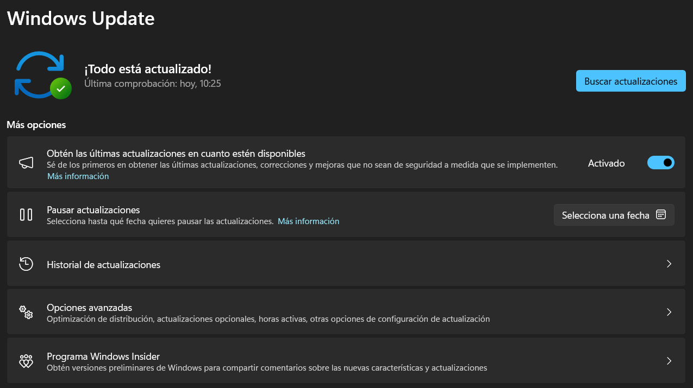
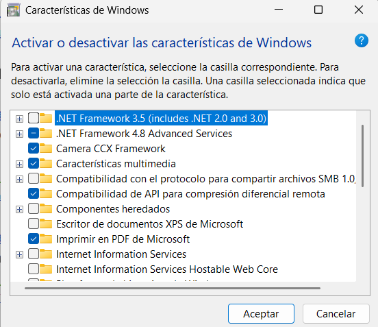
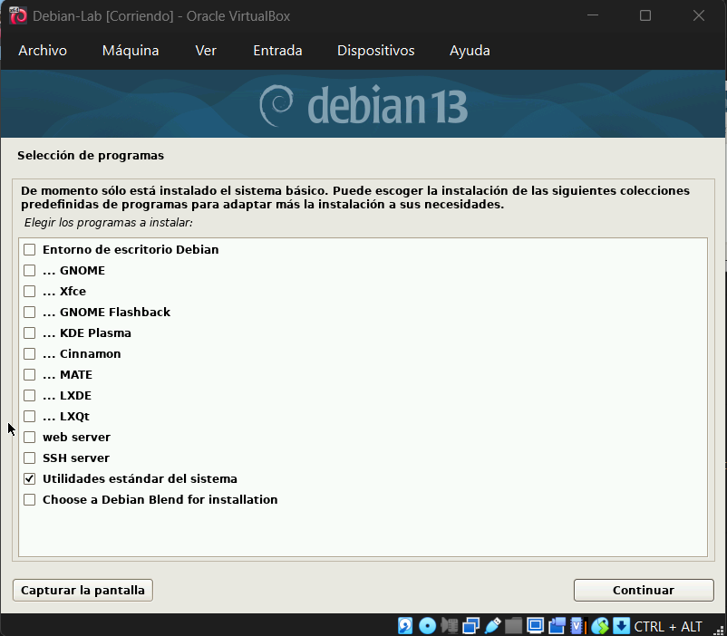
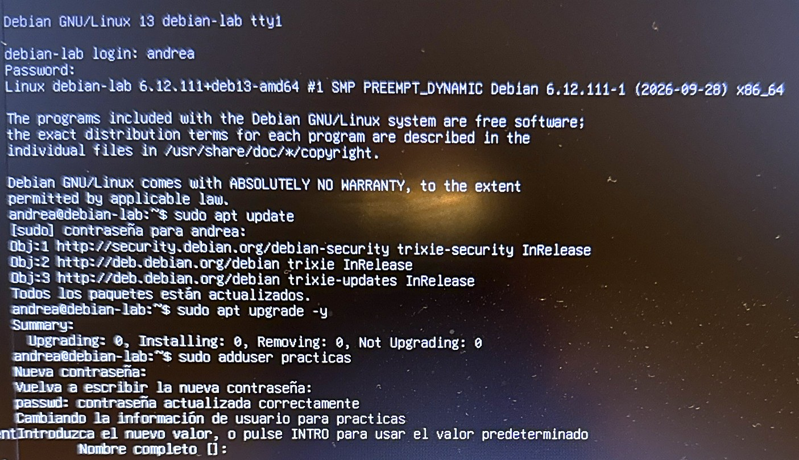
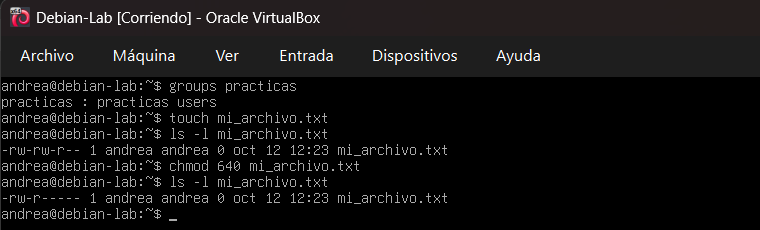
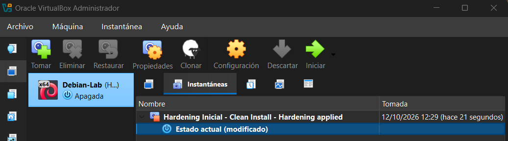

# Reporte Técnico de Configuración de Laboratorio

**Checkpoint 2 · Mi primer laboratorio seguro de ciberseguridad**
Andrea Fernández Trotta · Ciberseguridad · 12 de octubre de 2026

📄 Versión en PDF: [Reporte_Lab_Fernandez_Andrea.pdf](Reporte_Lab_Fernandez_Andrea.pdf)

## Introducción

Este reporte documenta la creación de una máquina de prácticas aislada para ejercicios de ciberseguridad. Se configuró una máquina virtual con Debian 13 en VirtualBox, se aplicó un hardening básico en el sistema invitado (Linux) y en el equipo anfitrión (Windows 11), y se guardó una instantánea del estado limpio como punto de restauración.

| Elemento | Configuración |
|---|---|
| Hipervisor | Oracle VirtualBox 7.2.20 + Extension Pack 7.2.20 |
| Sistema invitado | Debian GNU/Linux 13 (Trixie), 64 bits, sin entorno gráfico |
| Recursos asignados | 2 GB de RAM, 2 CPU, disco virtual de 20 GB |
| Red | NAT (Adaptador 1) |
| Equipo anfitrión | Windows 11 |

---

## 1. La fundación: VirtualBox y red aislada

Antes de encender la máquina virtual por primera vez se configuró el adaptador de red en modo **NAT**.

*Figura 1. Adaptador 1 conectado a NAT.*

### Por qué NAT y no Puente (Bridged)

En modo NAT la VM sale a Internet a través del anfitrión, como si estuviera detrás de un router propio: puede descargar actualizaciones y herramientas, pero ningún equipo externo puede iniciar una conexión hacia ella. Así la VM queda invisible para el resto de la red Wi-Fi de la casa.

El modo Puente se descartó porque conecta la VM directamente al router como un dispositivo más: quedaría expuesta a la red doméstica y, si se compromete con alguna herramienta de prueba, podría usarse para atacar a otros equipos (celulares, Smart TV). Cuando se trabaje con material sospechoso, la red se cambiará a "Red interna" o "No conectado".

### Otros puentes cerrados

Se deshabilitaron el portapapeles compartido y el arrastrar y soltar, y no se configuraron carpetas compartidas. Estos son los canales por los que un malware podría pasar de la VM al anfitrión.

*Figura 2. Portapapeles compartido y Arrastrar y soltar en "Inhabilitado".*

---

## 2. Capa Windows: usuarios y actualizaciones

El hardening de Windows se aplicó sobre el equipo anfitrión (Windows 11), que es el sistema que se busca proteger.

### Usuario estándar para el día a día

Se creó la cuenta local **UsuarioSeguro** con tipo **Usuario estándar**, separada de la cuenta de administrador. Aplica el principio de menor privilegio: si un programa malicioso se ejecuta desde esta cuenta, no tiene permisos para modificar el sistema sin pasar por el Control de Cuentas de Usuario (UAC).

*Figura 3. Cuenta "UsuarioSeguro" configurada como Usuario estándar.*

### Sistema actualizado

Windows Update confirma que no hay actualizaciones pendientes. Los parches cierran vulnerabilidades conocidas, que suelen explotarse a pocas horas de publicarse.

*Figura 4. Windows Update: "¡Todo está actualizado!".*

### Servicio innecesario deshabilitado: SMB 1.0

Se verificó que la característica "Compatibilidad con el protocolo para compartir archivos SMB 1.0/CIFS" esté desactivada. SMB 1.0 es un protocolo antiguo que el ransomware WannaCry usó para propagarse por la red.

*Figura 5. SMB 1.0/CIFS desactivado en las características de Windows.*

---

## 3. Capa Linux: permisos y gestión

### Instalación mínima, sin entorno gráfico

Durante la instalación se desmarcaron todos los entornos de escritorio y los servidores SSH y web; solo se dejaron las utilidades estándar del sistema. Cada programa instalado es una posible puerta de entrada, así que instalar lo mínimo reduce la superficie de ataque. Además, la cuenta root quedó sin contraseña (bloqueada) y el usuario principal administra el sistema mediante `sudo`.

*Figura 6. Selección de programas: solo "Utilidades estándar del sistema".*

### Actualización de paquetes

Con `sudo apt update` se actualizó la lista de paquetes desde los repositorios oficiales de Debian (incluido debian-security) y con `sudo apt upgrade -y` se instalaron las versiones nuevas. El resultado confirma que el sistema está al día.

*Figura 7. "Todos los paquetes están actualizados" y 0 paquetes pendientes.*

### Usuario sin privilegios y permisos de archivos

Se creó el usuario **practicas** con `adduser`. El comando `groups` muestra que pertenece solo a los grupos `practicas` y `users`, es decir, no está en el grupo `sudo` y no puede ejecutar tareas de administrador.

Luego se creó un archivo de prueba y se revisaron sus permisos con `ls -l`. Por defecto quedó en `-rw-rw-r--` (cualquier usuario podía leerlo). Con `chmod 640` se restringió a `-rw-r-----`: el dueño lee y escribe, el grupo solo lee y el resto no tiene acceso.

*Figura 8. `groups practicas`, `ls -l` y cambio de permisos con `chmod 640`.*

| Permiso | Valor | Significado |
|---|---|---|
| Antes | `-rw-rw-r--` (664) | Dueño y grupo leen y escriben; el resto lee. |
| Después | `-rw-r-----` (640) | Dueño lee y escribe; grupo solo lee; el resto, nada. |

---

## 4. La red de seguridad: snapshot inicial

Con la máquina apagada y el hardening aplicado, se tomó la instantánea **"Hardening Inicial - Clean Install - Hardening applied"**. Funciona como una máquina del tiempo: si una práctica rompe el sistema o lo infecta, se restaura este estado limpio en segundos, sin reinstalar.

*Figura 9. Administrador de instantáneas con el snapshot inicial.*

---

## Conclusiones

El laboratorio quedó listo para practicar sin poner en riesgo el equipo real. Las medidas aplicadas siguen la idea de defensa en profundidad:

- **Aislamiento:** red NAT, sin portapapeles, arrastrar y soltar ni carpetas compartidas.
- **Menor privilegio:** usuario estándar en Windows, usuario sin `sudo` en Linux y root bloqueado.
- **Actualizaciones:** Windows Update y apt al día.
- **Menor superficie de ataque:** Debian sin entorno gráfico ni servidores, y SMB 1.0 desactivado.
- **Recuperación:** snapshot del estado limpio antes de empezar a practicar.
